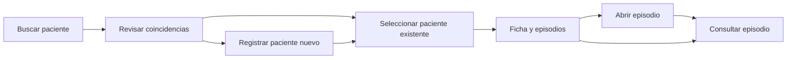

# Plan V2 — Interfaz local de Pacientes y Admisión

Fecha: 2026-10-02. Actualizado: 2026-10-03. Estado: V2-01 completada técnicamente;
ampliación administrativa aprobada el 2026-10-03 y concretada en contrato revisión 2.
V2-02A completada y comprobada el 2026-10-03. Revisión visual no realizada.
Siguiente fase de ejecución: **V2-02B — Altas idempotentes y publicación de POST V2**.
Base: V1-01–07 completadas, commit `df01151` en la rama local `main`.

## Objetivo y autorización

Permitir completar desde el navegador el recorrido búsqueda → selección o alta
de paciente → apertura de episodio → consulta, con permisos aplicados por el
servidor, identificación permanente del paciente y reintentos que no dupliquen altas.

El usuario solicitó crear este plan después de guardar V1 en Git y el 2026-10-03
indicó «continua con v2», autorizando su ejecución local. Continuar los pasos normales
sin confirmación repetida, respetando permisos efectivos del entorno y las puertas
de revisión humana. Esta autorización no aprueba por adelantado bocetos/contratos
todavía no presentados ni autoriza despliegues o servicios externos.
Después aprobó la ampliación recomendada con «ok hazlo entonces»: incorporar
campos administrativos, caracterización del desconocido, ingreso y verificación
trazable. Esta decisión sustituye el recorte original de campos y permite continuar
su desarrollo normal; no pedir otra autorización para la misma ampliación.
Solicitud documental previa: registrar esta implementación prevista, crear
su plan dentro de V2 y dejarla como la siguiente fase. Se atiende con V2-02A abajo;
aquella actualización no ejecutó migraciones ni convirtió el diseño en código terminado.
Posteriormente el usuario indicó «continua con la sig fase de v2», autorizando
la ejecución de V2-02A; resultados y límites registrados en su evidencia.

Referencias: [estado operativo](../ESTADO.md), [propuesta técnica](../docs/propuesta-tecninca.md),
[plan V1](v1-base-backend.md), [contrato vigente](../docs/contrato-v1.md),
[evidencia V1](../docs/validacion-v1.md),
[Pacientes](../docs/requerimientos/2.%20PACIENTE.md) y
[Admisión](../docs/requerimientos/1.%20ADMISION.md).

## Alcance

- Frontend local React y TypeScript conectado a la API real FastAPI/PostgreSQL.
- Búsqueda por folio, nombre e identificador disponible; resultados paginados y
  coincidencias visibles antes de crear. No deducir identidad por parecido.
- Ficha administrativa con campos autorizados, estado provisional/verificado y
  lista paginada de episodios. Diferenciar paciente, episodio y expediente;
  no presentar una ficha administrativa como expediente clínico implementado.
- Alta con búsqueda previa; urgencia con identidad completamente desconocida;
  identidad verificada sólo para el actor con patients.verify_identity.
- Perfil administrativo: sexo registrado, nacionalidad, teléfonos, domicilios y
  contactos de emergencia múltiples; datos conocidos/ausentes explícitos.
- Desconocido: sexo aparente, rango de edad estimada, características, procedencia
  y traslado opcionales, sin inventar identidad ni nacimiento.
- Apertura emergency/outpatient/inpatient con ingreso, sede/servicio, procedencia
  y motivo referido; fecha clínica distinta de registro, urgencias con pendientes.
- Verificación con dos identificadores contrastados y fuente/actor/fecha; declaraciones
  V1 sin evidencia se distinguen. Rutas ampliadas /api/v2 conservan clientes V1.
- Permisos y errores de servidor en la interfaz, correlación para diagnóstico y
  vista de auditoría existente sólo para supervisor-demo.
- Idempotencia de las altas de paciente y episodio, persistida en PostgreSQL;
  protección contra doble envío y respuesta perdida.
- Pruebas de navegador sobre API/base reales y revisión funcional explícita.

V2 permanece local y usa exclusivamente datos ficticios. El selector de actores
de demostración no autentica personas y estará disponible sólo en modo de
desarrollo explícito. Identidad del backend apagada por defecto; producción con
identidad simulada sigue rechazándose. No guardar datos del paciente, cuerpos de
alta ni respuestas en localStorage, sessionStorage o cachés persistentes del navegador.

## Fuera de V2

Autenticación real, contraseñas propias, Cognito/Keycloak, AWS y acceso compartido;
edición o enriquecimiento posterior de identidad; fusiones/separaciones;
contactos fiscales/legales y documentos adjuntos; notas, firma, alergias y supervisión clínica;
cierre/conversión de episodios, camas, traslados, cobros, farmacia e integraciones.
No añadir eliminación ordinaria de pacientes/episodios. No afirmar capacidad
productiva, cumplimiento normativo ni cobertura total de Admisión/Pacientes.
Prioridad/triage diferidos hasta definir su catálogo y flujo clínico; no valores
inventados ni selector de gravedad. [Campos/reglas acordados](../docs/campos-v2.md).

## Recorrido y pantallas propuestas

| Pantalla/ruta propuesta | Contenido y acciones |
|---|---|
| `/patients` | Filtros, estados de carga/vacío/error, candidatos y paginación; entrada al registro de desconocido. No pedir un listado global sin filtros que V1 no ofrece. |
| `/patients/new` | Borrador ligado a búsqueda/actor/datos; perfil, contactos/domicilios múltiples, descriptores desconocidos y evidencia de verificación; confirmación. |
| `/patients/:id` | Identificación visible, campos permitidos y episodios; entrada explícita a abrir una nueva atención. |
| `/patients/:id/admissions/new` | Identificación, tipo, datos de ingreso/catálogos y confirmación de pendientes; resultado muestra folio de episodio. |
| `/admissions/:id` | Episodio y paciente asociado; volver a su ficha sin mezclar ambos folios. |
| `/audit` | Filtros y paginación sobre el endpoint existente, sólo con audit.read. |

Folio y estado del paciente permanecerán visibles en ficha/formularios/episodio.
El texto «Identidad desconocida» será una etiqueta de presentación, sin enviarlo
como nombre inventado. Los estados de error conservarán un borrador sólo mientras
siga activo el mismo paciente y actor. Cambiar paciente o actor cancela peticiones,
descarta respuestas atrasadas y limpia datos/borradores del contexto anterior.
Una URL directa o recarga debe resolver y autorizar su contexto desde el servidor.

## Diseño técnico y dependencias

Reutilizar backend, permisos, proyecciones, errores, migraciones y auditoría de V1.
Mantener separadas vistas, cliente HTTP y lógica del recorrido en `frontend/`.
React/TypeScript son la propuesta vigente; herramienta de construcción, router,
cliente y pruebas se elegirán en V2-01 con evidencia del equipo y fuentes oficiales.
No fijar versiones sin comprobar compatibilidad. Conservar lock reproducible.

Preferir proxy local `/api` hacia FastAPI para evitar ampliar CORS por defecto.
Servidores publicados sólo en loopback; si se requiere CORS, permitir únicamente
orígenes locales explícitos y documentarlos. No colocar secretos de base en variables
del frontend. Las llamadas sensibles conservan auditoría; no persistir su caché.
La configuración de desarrollo no habilitará identidad por el mero build del frontend.

El cliente consultará `/identity/me` para mostrar acciones permitidas. Ocultar un
botón no sustituye autorización del servidor; 401/403 limpian datos sensibles del
contexto y explican acceso no disponible. Los campos ausentes por permiso no se
mostrarán como datos desconocidos ni se completarán mediante otra llamada indebida.

### Contrato propuesto de idempotencia

Precisar y registrar en V2-01 antes de cambiar endpoints:

- El cliente crea una clave aleatoria por intención de alta. Un reintento usa la
  misma clave y el mismo cuerpo congelado; una nueva atención usa otra clave.
- Cabecera propuesta `Idempotency-Key` en POST /patients y POST /admissions.
  Decidir su obligatoriedad y compatibilidad con clientes V1 en el contrato V2;
  no cambiar silenciosamente el comportamiento de solicitudes sin cabecera.
- Reserva UNIQUE por actor interno, operación y clave; huella del cuerpo
  normalizado y referencia al recurso resultante. No guardar una copia de
  demografía en el registro ni escribir claves/cuerpos en logs técnicos.
- Registro de idempotencia, recurso y evento de creación comparten transacción.
  Un rollback no deja una clave exitosa ni consume permanentemente la intención.
- Clave/cuerpo iguales devuelven el recurso ya creado, su Location y señal explícita
  de repetición. No generan un segundo recurso ni otro evento de creación exitosa.
  Cada solicitud conserva su correlación y trazabilidad según contrato.
- Clave reutilizada con cuerpo distinto produce conflicto controlado. Resolver
  solicitudes simultáneas con restricción/transacción real y espera acotada;
  definir código y recuperación cuando una solicitud siga en curso.
- Revalidar identidad y permisos antes de consultar/reproducir el resultado;
  devolver proyección vigente. Nunca reproducir una respuesta sensible guardada
  después de revocar permisos, ni revelar resultados de otro actor.
- Un replay confirmado se resuelve sin exigir una búsqueda aún vigente;
  una creación nueva sigue exigiendo búsqueda válida, actor y datos compatibles.
  V1 no consume el acuse de búsqueda; corrección comprobada en V2-01.
- Fijar ventana de retención, conducta tras expiración y recuperación tras recarga.
  La interfaz no reintentará automáticamente una operación incierta si perdió su
  clave/cuerpo o venció la garantía: ofrecer consulta/reconciliación antes de otra alta.
  Dos solicitudes con claves distintas pueden representar dos episodios legítimos.

## Fases y aceptación

### V2-01 — Contrato del recorrido y entorno

Depende de V1 entregada. Completada técnicamente el 2026-10-03; revisión 2 incorpora
la corrección de alcance aprobada. Recorrido visual manual no realizado.

- [x] Comprobar entorno frontend disponible y seleccionar versiones/herramientas
  con fuentes oficiales; separar disponibilidad de instalación autorizada.
- [x] Concretar pantallas, navegación, permisos y estados de error con bocetos.
- [x] Definir contrato V2: idempotencia, replay/retención/compatibilidad, errores,
  correlación, proyecciones, contexto y manejo de búsqueda vigente de V1.
- [x] Definir comandos y matriz de pruebas, datos ficticios y separación de bases.

Aceptación: contrato y bocetos revisables; casos de búsqueda/alta/desconocido/reintento
sin contradicción con V1; decisiones y fuentes verificables. M2-01 preparada.
Entregables previstos: contrato V2 y bocetos en docs, selección de dependencias
comprobada y registro de cobertura. Crear cada archivo cuando tenga contenido real.

Entregados: [contrato revisión 2](../docs/contrato-v2.md),
[campos ampliados](../docs/campos-v2.md),
[boceto navegable local](../docs/bocetos-v2.html),
[matriz y comandos](../docs/validacion-v2.md) y
[evidencia/guion M2-01](../docs/evidencia-v2-01.md).
Compatibilidad de herramientas comprobada por metadatos oficiales; instalación,
lock, build e integración pendientes de V2-03. API/base sin cambios en V2-01.
Decisiones técnicas: cabecera opcional en API V1 y obligatoria en API/cliente V2;
replay 200 durante 24 h; reserva de claves vencidas sin reutilización;
espera acotada 5 s; reconciliación manual tras pérdida del contexto en memoria.

Revisión del 2026-10-03: aprobación del usuario condicionada a concordancia con
requerimientos. [Contraste de campos](../docs/evidencia-v2-01.md) acredita un
subconjunto V2, con omisiones de mínimos de Admisión y reglas de verificación.
Posteriormente el usuario aprobó ampliar los campos y ajustar verificación;
se concretó esa decisión en revisión 2. No atribuir aprobación visual ni clínica.

### V2-02 — Backend administrativo ampliado y altas idempotentes

Depende de V2-01; precede a formularios de escritura. Se divide en las dos fases
de ejecución siguientes, conservando los identificadores del resto del plan.
V2-02A completada; V2-02B pendiente. Cada fase conserva evidencia independiente.

#### V2-02A — Implementación del backend administrativo ampliado

Estado: **completada y comprobada el 2026-10-03**. Alcance aprobado por el usuario.
Entradas: [contrato revisión 2](../docs/contrato-v2.md),
[campos y reglas](../docs/campos-v2.md), [matriz de pruebas](../docs/validacion-v2.md).
Objetivo: persistir y consultar la ampliación administrativa sobre PostgreSQL,
preparando los servicios de alta que V2-02B publicará con idempotencia.

Registro vigente: migración 0005 aplicada en desarrollo/pruebas, modelos, servicios,
catálogos ficticios, permiso de intake y lecturas V2 implementados. A01–A08,
276 pruebas y HTTP real comprobados; POST V2 permanece deshabilitado.

| Bloque | Implementación incluida |
|---|---|
| Paciente | Sexo registrado, nacionalidad, teléfonos/domicilios/contactos múltiples, calidad y razones de ausencia. |
| Desconocido | is_unidentified y descripción opcional: sexo aparente, rango estimado, características, procedencia y traslado. Sin nacimiento/identidad inventados. |
| Verificación | Nombre más nacimiento/CURP contrastados, fuente por campo, instantánea, actor y fecha servidor; declaración V1 sin evidencia identificable. |
| Ingreso | admitted_at separado de created_at, sede/servicio, procedencia y motivo. Urgencias admite pendientes; consulta/hospitalización exigen fecha/sede/servicio. |
| Seguridad | Proyecciones según patients.read_demographics y admissions.read_intake; permisos compuestos y auditoría atómica. |
| Compatibilidad | UUID, folios, reservas de identificadores y API V1 conservados; consultas ampliadas bajo /api/v2. |

Pasos de implementación, en este orden:

1. **Fijar la base y el esquema físico.**
   - [x] Revisar cambios, procesos, migración vigente y datos ficticios existentes
     antes de arrancar servicios o aplicar migraciones; registrar el punto de partida.
   - [x] Traducir campos/reglas a modelos y tablas: perfiles/descriptores, colecciones
     subordinadas, verificación/evidencia, intake y catálogos de sede/servicio.
   - [x] Definir FK restrictivas, índices, unicidad, coherencia state/value, rango
     estimado y pareja sede/servicio; integridad verificación/estado al commit.
2. **Migrar sin fabricar datos y preparar catálogos/permisos.**
   - [x] Crear migración Alembic posterior a 0004 y actualizar metadata ORM.
     Pacientes/episodios V1 mantienen UUID/folios/fechas/autores; datos nuevos ausentes
     conservan not_provided. No inventar evidencia ni convertir created_at en ingreso.
   - [x] Sembrar sedes/servicios exclusivamente ficticios y admissions.read_intake
     para admision-demo/supervisor-demo en transacción; consulta-demo no lo recibe.
     Repetir semilla conserva filas/UUID, suspensiones y datos ajenos.
3. **Implementar contratos y servicios de negocio.**
   - [x] Esquemas de ausencia/calidad, perfil y listas con límites/normalización;
     rechazar contradicciones, campos extra y valores de sólo servidor.
   - [x] Alta desconocida sin requisitos descriptivos; edad estimada separada de
     nacimiento y sexo aparente separado de registrado.
   - [x] Verificación con permiso y dos identificadores válidos/fuentes; TEST,
     folio o nombre sólo no bastan. Guardar evidencia, recurso y auditoría juntos.
   - [x] Ingreso con zona/UTC, fecha no futura, catálogos activos/coherentes y
     validación por tipo; servicios de alta reutilizan búsqueda/reservas V1.
4. **Integrar lecturas V2, permisos y compatibilidad.**
   - [x] GET /api/v2/patients, /patients/{id}, /admissions/{id},
     /patients/{id}/admissions y /catalogs/sites|services según contrato;
     autorización, paginación, errores/correlación y auditoría de cada acceso.
   - [x] Campos sensibles omitidos del JSON sin sus permisos; read_intake nunca
     concede admissions.read. verified V1 sin evidencia se muestra como declaración
     anterior, sin migrar artificialmente su calidad a documented.
   - [x] Conservar esquemas/respuestas V1, identidad local apagada por defecto y
     rechazo en producción; sin datos personales nuevos en logs ni cachés persistentes.
5. **Probar y cerrar el hito con evidencia.**
   - [x] A01–A08 de la matriz: esquemas, servicios sobre PostgreSQL, SQL directo
     para restricciones, rollback y consultas HTTP reales; regresión funcional V1.
   - [x] Migración desde cero y sobre V1 con datos, upgrade repetido y Alembic check;
     comparar identidad/folios/datos/secuencias anteriores y posteriores.
   - [x] Preparación repetible conserva configuración/base; registrar comandos,
     versiones, resultados, limitaciones y entidades ficticias conservadas.

Límite de publicación: en V2-02A se comprueban altas por servicios sobre PostgreSQL
y consultas por HTTP. **No habilitar POST V2 sin la garantía de idempotencia**:
sus rutas de escritura se integran/activan en V2-02B. Hasta entonces no afirmar
recorrido HTTP de alta V2 operativo; los POST V1 existentes siguen su contrato.
Así se evita publicar un endpoint V2 que exige clave pero todavía puede duplicar.

Aceptación V2-02A: A01–A08 y regresión V1 pasan en sus capas indicadas; migración
nueva/repetida/check sin divergencias; datos V1 preservados; permisos/ausencias/
verificación y consultas HTTP comprobados. Toda escritura y auditoría comparten
transacción. No basta la existencia de tablas, esquemas o documentación.

Entregados: migración/modelos, semilla de catálogo/permiso, esquemas, servicios,
proyecciones, rutas GET y pruebas. [Evidencia y comandos](../docs/evidencia-v2-02a.md),
[resultados](../docs/evidencia/v2-02a-resultados.json) y
[verificador](../backend/scripts/verify_v2_02a.py).
Comando ejecutado: `backend/.venv/bin/python backend/scripts/verify_v2_02a.py --baseline /tmp/reimbow-v2-02a-baseline.json`.
La referencia temporal acredita la transición de esta sesión desde 0004;
sin ese argumento el verificador conserva y comprueba la base vigente.

Fuera de V2-02A: frontend, idempotencia (V2-02B), prioridad/triage, camas, aseguradoras,
cobros, adjuntos, edición/enriquecimiento posterior y clínica completa. El permiso
intake no sustituye futuras restricciones clínicas ni se declara autenticación real.

#### V2-02B — Altas idempotentes y publicación de POST V2

Estado: pendiente. Depende de V2-02A; precede a formularios de escritura V2-05.

- [ ] Migración y servicio compartido de idempotencia con operación versionada,
  integrados con altas V1/V2; publicar POST V2 y Location de su versión.
- [ ] Clave opcional V1/obligatoria V2, replay 200/24 h y reserva vencida sin
  reutilización; huella de perfil/ausencias/evidencia/intake completos.
- [ ] Misma clave/cuerpo, conflicto, actores/versiones distintos, rollback y
  reintento tras respuesta perdida/búsqueda expirada (V1 no la consume).
- [ ] Conexiones distintas con barrera: un recurso/evento de creación para el
  mismo intento; claves diferentes conservan episodios independientes; espera 5 s.
- [ ] Permisos actuales en replay, sin nueva evidencia de verificación ni fechas;
  caída/reinicio y retención comprobados con API real/PostgreSQL.

Aceptación: I01–I13, A09 y R01 pasan; se completa la comprobación HTTP de altas
ampliadas y regresión V1. Migración nueva/repetida/check sin divergencias, sin
deduplicación clínica por parecido. A10 y recorrido de navegador siguen en V2-05/06.
Entregables: migración, servicio/rutas POST, pruebas y evidencia de idempotencia.

### V2-03 — Base frontend e identidad local

Depende de V2-01; puede avanzar junto con V2-02 cuando ambas estén autorizadas.

- [ ] Estructura React/TypeScript, lock, arranque/build y proxy loopback.
- [ ] Cliente HTTP con correlación/errores y rutas directas/recarga.
- [ ] Modo demo explícito y consulta de permisos; rechazo cuando está deshabilitado.
- [ ] Cambio de actor/contexto limpia cachés/borradores y peticiones pendientes.
- [ ] Estados de carga/error accesibles, campos etiquetados y foco por teclado.

Aceptación: navegador conecta a API real, modo apagado rechaza rutas protegidas,
actor no obtiene permisos por alterar UI y frontend no contiene credenciales.

### V2-04 — Búsqueda, ficha y episodios de lectura

Depende de V2-03 y de las lecturas/catálogos completados en V2-02A.

- [ ] Filtros de V1, candidatos, paginación y selección sin fusión automática.
- [ ] Ficha ampliada autorizada y listado/consulta de episodios; intake sólo con
  admissions.read_intake y calidad de verificación visible sin revelar evidencia.
- [ ] Identificación permanente y cancelación de resultados fuera de contexto.
- [ ] Recarga/URL directa, 401/403/404 y límites de campos para consulta-demo.

Aceptación: datos coinciden con API; demografía restringida no aparece en UI/cachés,
una búsqueda atrasada no sustituye la vigente y los folios se distinguen. M2-02 preparada.

### V2-05 — Registro y apertura de episodios

Depende de V2-02A, V2-02B y V2-04.

- [ ] Alta ligada a búsqueda válida; modificación de datos invalida evidencia
  incompatible; preservar borrador y solicitar nueva búsqueda cuando expire.
- [ ] Alta ampliada/desconocida y verified con permiso/evidencia; listas de contactos,
  razones de ausencia y descriptores separados, sin datos inventados.
- [ ] Captura de ingreso/catálogos, pendientes en emergency y campos requeridos
  en outpatient/inpatient; sin selector de prioridad ni triage improvisado.
- [ ] Confirmación de paciente/tipo antes de abrir atención y resultado con folio.
- [ ] Bloqueo de doble envío, reintento idempotente y conflictos explicados.
- [ ] Consulta autorizada de auditoría para comprobar el recorrido.

Aceptación: recorrido completo desde navegador con paciente existente, nuevo y
desconocido; 409/422 permiten corregir sin duplicar; permisos comprobados también
con peticiones directas. Abrir otra atención es una nueva intención explícita.

### V2-06 — Recuperación, validación y entrega

Depende de V2-01–05.

- [ ] Suite backend sobre PostgreSQL y pruebas de navegador sobre API real;
  aislamiento de test, sin escrituras clínicas de prueba en hospital_dev.
- [ ] Respuesta perdida después de commit, doble clic, petición concurrente,
  cambio de paciente/actor con respuesta tardía, búsqueda expirada y base caída.
- [ ] Comprobar falta de autorización, campos restringidos, navegación por teclado,
  identificación visible y errores con correlación sin datos sensibles.
- [ ] Preparación repetible, guía de instalación/arranque/build/pruebas, comandos
  reproducibles, resultados y límites; conservar evidencia original V1.
- [ ] Preparar M2-03 y registrar respuesta explícita; actualizar plan y ESTADO.

Aceptación técnica: otra sesión reproduce recorrido, permisos y reintentos sin
duplicados; scripts preservan bases/configuración; regresión V1 pasa.
Aceptación funcional: M2-03 aprobada explícitamente. Si falta, registrar «validación
técnica completada; revisión funcional pendiente», sin declarar aprobación humana.

## Puertas de revisión funcional

M2-01 recibió corrección de campos y aprobación de ampliación; no revisión visual.
M2-02/03 siguen pendientes. Al preparar estas revisiones,
añadir comando real de inicio, URL, actores, datos ficticios y evidencias disponibles.
Mientras estén pendientes, avanzar sólo trabajo independiente ya autorizado.

| Puerta | Inicio y pasos previstos | Resultado esperado y registro |
|---|---|---|
| M2-01, después de V2-01 | Revisión 2 atiende campos/reglas ampliados aprobados; boceto preparado para recorrido visual. | Corrección de alcance aprobada con «ok hazlo entonces»; desarrollo autorizado, revisión visual no ejecutada. No sustituir aceptación clínica por aprobación del agente. |
| M2-02, después de V2-04 | Iniciar frontend/API según guía; buscar/seleccionar dos pacientes, paginar, abrir fichas y cambiar actor. | Identificación/cambio evidentes, campos limitados y navegación comprensibles; guardar respuesta explícita. |
| M2-03, después de V2-06 | Completar alta → episodio → consulta; registrar desconocido; doble clic/reintento simulado; comprobar consulta-demo y auditoría de supervisor. | Mismo intento no duplica, urgencia admite desconocidos, errores recuperables y permisos claros; guardar resultado, observaciones y evidencia. |

## Trazabilidad y límites de cobertura

| Origen | Criterio V2 | Límite |
|---|---|---|
| PAT-RF-001/004/005; ADM-RF-004 | Registro visible, folio/UUID servidor y desconocido sin CURP/datos inventados. | Sin enriquecimiento posterior ni recién nacido especializado. |
| PAT-RF-002/003; ADM-RF-001/002 | Búsqueda/candidatos preceden alta, identidad no se confirma por coincidencia y conflicto exacto es recuperable. | Filtros V1; sin fonética/fusión ni cobertura total de identificadores. |
| ADM-RF-003; ADM-RNF-001 | Seleccionar paciente y abrir episodio; desconocido abre emergency con datos mínimos. | Sin camas, preadmisión, conversión ni cobros. |
| PAT-RNF-002/008; ADM-RNF-004 | Campos por permiso, identificación consistente y limpieza al cambiar contexto. | Identidad local; sin autenticación real ni identidades protegidas avanzadas. |
| Pacientes §5–10/13; PAT-RF-008 | Perfil, teléfonos/domicilios/contactos múltiples y descripción del desconocido; ausencias explícitas. | Sin edición, documentos, todos los responsables legales ni caracterización completa. |
| Pacientes §6–7; Admisión §8 | Nombre más nacimiento/CURP, evidencia y autor/fecha; V1 sin evidencia distinguida. | Sin comprobación externa ni verificación posterior; exclusivamente demo. |
| Admisión §10–11; ADM-RF-005 parcial | Fecha de ingreso, sede/servicio coherentes, procedencia y motivo; permisos de intake. | Prioridad/triage, camas, diagnósticos y mínimos completos diferidos. |
| PAT-RNF-003/004/005; ADM-RNF-005 | Auditoría de altas y reintentos, folios estables y sin borrado ordinario. | Sin edición/identidad corregida ni promesa frente a administrador de base. |
| Fiabilidad del recorrido | Idempotencia y pérdida de respuesta comprobadas en PostgreSQL/HTTP/navegador. | No deduplicación de intenciones distintas ni garantía fuera de retención. |
| PAT-RNF-001; ADM-RNF-002 | Registrar tiempos observados de interfaz y configuración de medición. | Gran volumen/SLA siguen diferidos; sin extrapolar diagnóstico V1. |

PAT-RF-006/007 y los flujos clínicos/administrativos completos siguen diferidos.
Cada evidencia indicará caso, entorno/versiones, comando, resultado y limitación;
ninguna casilla se marca por tener sólo un documento, endpoint o captura.

## Próximo paso

La siguiente fase es **V2-02B**, con idempotencia/publicación de altas.
Después V2-03 (base frontend),
sin pedir confirmación repetida para el alcance ya aprobado.
M2-01 conserva revisión visual pendiente, sin bloquear la implementación aprobada.
Backend V2-02A acreditado en [su evidencia](../docs/evidencia-v2-02a.md).
PostgreSQL permanece activo en loopback; API temporal cerrada, identidad apagada
por defecto. Frontend, POST V2 e idempotencia pendientes; sin aceptación clínica.
